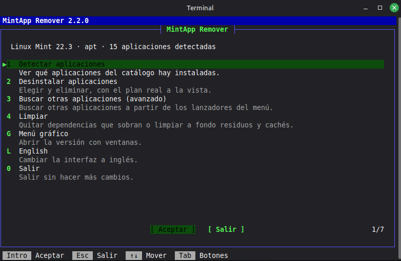
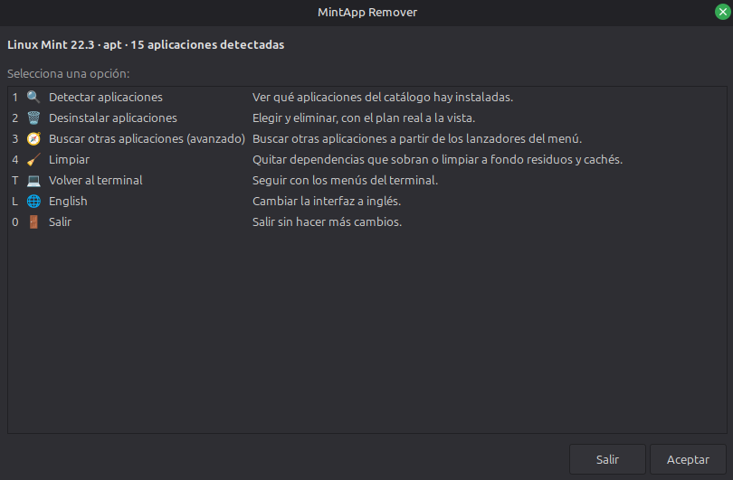
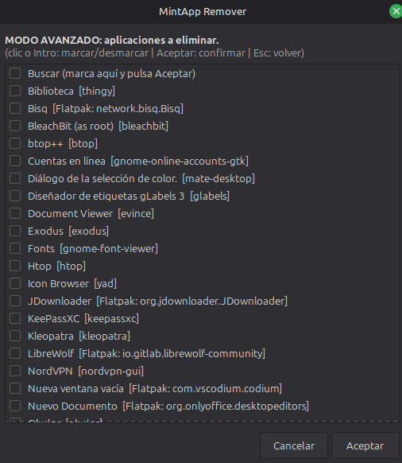
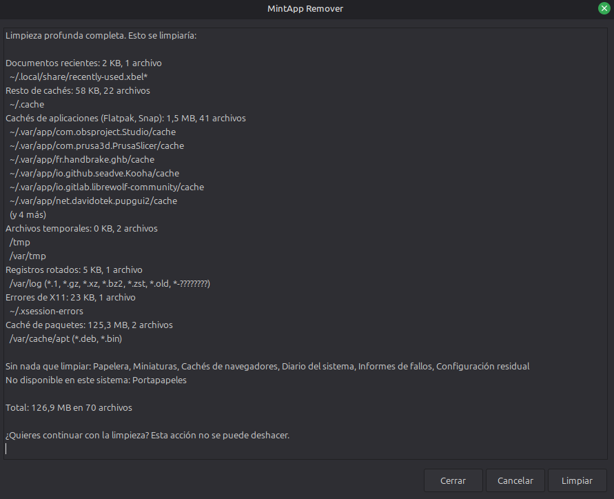
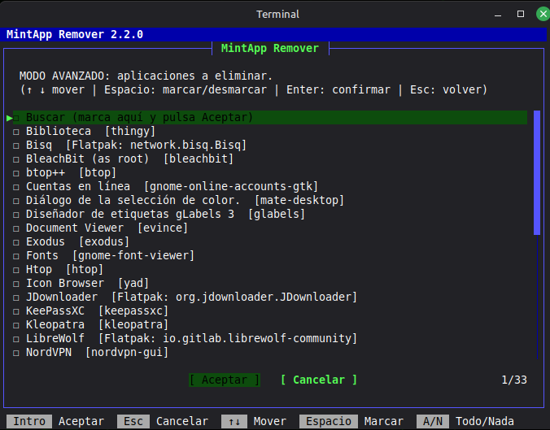
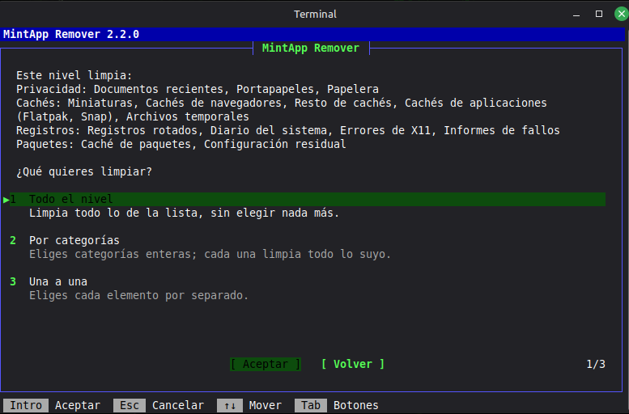

<p align="center">
  
</p>

<h1 align="center">MintApp Remover</h1>

<p align="center">
  Desinstalador y limpiador para Linux, en español e inglés.<br>
  Un único script de Bash que te enseña exactamente qué va a quitar antes de quitarlo.
</p>

<p align="center">
  <a href="README.md">English</a> · <b>Español</b>
</p>

<p align="center">
  <a href="LICENSE.txt"></a>
  
  
</p>

---

## Novedades

Versión 2.2.0:

- **Ahora es bilingüe: español e inglés.** Hasta ahora el programa solo hablaba español. Cada menú, plan, mensaje y texto de ayuda sale ya en cualquiera de los dos idiomas: sigue el idioma de tu sistema y `L` lo cambia en cualquier momento. Este README también está en los dos idiomas.
- **Un limpiador de verdad, no solo de dependencias.** La opción 4 es ahora un limpiador al estilo de [BleachBit](https://www.bleachbit.org/) con valores por defecto seguros: cachés, registros, archivos temporales y rastros de uso, en dos niveles (simple y completo), mostrando siempre antes qué y cuánto se borra. Limpiar dependencias es ahora solo una de sus dos acciones.
- **Más allá de apt.** `dnf` (versión 4), `pacman` y `zypper` son compatibles (ver [Compatibilidad](#compatibilidad)). El gestor se elige al arrancar; `MINTAPP_PM` fuerza uno.
- **Flatpak y Snap se pueden quitar.** Aparecen en la opción 3 junto a los paquetes, con su propio plan, su confirmación y su registro.
- **Un catálogo para cada escritorio.** Cinnamon, GNOME, KDE Plasma, XFCE y MATE tienen cada uno su lista de aplicaciones y su lista de componentes del sistema que se dejan en paz.
- **Comandos `install` y `uninstall`.** `install` pone un comando, un lanzador de menú y el icono en tus propias carpetas, sin `sudo`. Si no hay terminal, el lanzador abre el menú gráfico, o un terminal si esa fue tu última elección (`T`).
- **Guarda de metapaquetes.** Si un plan arrastra también metapaquetes (los que mantienen unido a todo un escritorio), te avisa y hace una pregunta más exigente.
- **Un icono, dentro del script.** El icono viaja incrustado en el script, así que el archivo que descargas es lo único que necesitas.
- **Sigue siendo seguro.** El plan se simula, se muestra, se confirma y se vuelve a comprobar antes de quitar nada, y cada eliminación deja un registro.

## Qué es

Es una herramienta pequeña y directa para dos tareas, las dos sin sorpresas: quitar programas de forma ordenada y limpiar lo que un sistema va acumulando (cachés, registros, archivos temporales, rastros de uso).

En una instalación nueva de Linux siempre hay algún programa que nunca utilizarás. Quitarlos a mano implica saber el nombre exacto del paquete (que casi nunca coincide con el que ves en el menú) y confiar en que la eliminación no se lleve algo que no debería. **MintApp Remover** resuelve las dos cosas: te da una lista con casillas de las aplicaciones y, antes de quitar nada, te enseña el resultado real de la operación.

La limpieza funciona al estilo de [BleachBit](https://www.bleachbit.org/), con valores por defecto pensados para que sea segura: dos niveles (el simple tiene límites de antigüedad), no se borra nada antes de que veas qué y cuánto, la respuesta por defecto es «no», y la papelera, que no se puede deshacer, nunca viene marcada de antemano. Mira la opción 4 más abajo.

No es un «optimizador» ni promete liberar gigas milagrosos.

### Capturas

Versión 2.2.0 en Linux Mint 22.3 con `apt`. El programa trabaja en el terminal por defecto y en ventanas cuando pulsas `G` (o cuando arranca sin terminal).

<p align="center">
  
  <br><em>El menú principal en el terminal. La primera línea dice lo que encontró el programa: el sistema, el gestor de paquetes y cuántas aplicaciones del catálogo están instaladas.</em>
</p>

<p align="center">
  
  <br><em>El mismo menú en ventanas (`zenity`). `T` vuelve al terminal.</em>
</p>

<p align="center">
  
  <br><em>La opción 3, modo avanzado, en ventanas: aplicaciones encontradas a partir de los lanzadores del menú, cada una con su paquete. Las de Flatpak muestran su ID.</em>
</p>

<p align="center">
  
  <br><em>La opción 4, limpieza profunda (nivel completo), en ventanas. Antes de borrar nada, la lista dice qué se limpiaría, dónde y cuánto. La respuesta por defecto es `Cancelar`.</em>
</p>

<p align="center">
  
  <br><em>La opción 3 en el terminal: la misma lista. La última fila enseña las teclas que valen en la pantalla.</em>
</p>

<p align="center">
  
  <br><em>La opción 4, limpieza profunda, en el terminal: lo que limpia el nivel y, debajo, qué quieres limpiar: todo el nivel, por categorías o una a una.</em>
</p>

## Ventajas

La mayoría de los scripts de este estilo que circulan por foros son una lista fija de `sudo apt purge paquete1 paquete2 paquete3...`. Si algún nombre de paquete cambió entre versiones, o si tienes algo instalado que el autor del script no consideró, te quedas a medias o, peor, confías ciegamente en una lista que no revisaste.

MintApp Remover hace las cosas de otra manera:

- **No quita nada sin que antes veas el plan real del gestor de paquetes.** Con apt ejecuta `apt-get -s purge` (una simulación: no cambia nada y no necesita permisos de administrador) y te lo muestra tal cual, incluido cualquier paquete dependiente que apt decida arrastrar. Confirmas (la respuesta por defecto es «no»), se vuelve a comprobar el plan y solo entonces pide tu contraseña.
- **El modo avanzado no depende de una lista fija.** Escanea los lanzadores reales del menú de aplicaciones (archivos `.desktop`) y le pregunta al gestor de paquetes de quién es cada uno, así que encuentra aplicaciones que el catálogo no conoce.
- **Deja rastro.** Cada eliminación se guarda en un archivo privado con lo que se planeó y el comando para reinstalarlo.
- **La limpieza es prudente por defecto.** Muestra qué y cuánto antes de borrar, la respuesta empieza en «no», solo toca archivos normales en una lista fija de lugares, nunca sigue enlaces, nunca sale del sistema de archivos en el que empezó y nunca borra un archivo que un programa en marcha tenga abierto.
- **Se adapta al terminal que tengas.** Sin colores con `NO_COLOR`, ASCII puro cuando la configuración regional no es UTF-8, un menú de texto cuando no quieres `whiptail` y ventanas (`zenity`) cuando no hay terminal.

## Compatibilidad

El requisito es `bash` 4.3 o superior, más las herramientas de un gestor de paquetes compatible. El programa las comprueba al arrancar y dice qué falta.

| Nivel | Sistema | Estado |
|---|---|---|
| 1 | Debian, Ubuntu y derivadas (Linux Mint, Pop!_OS, Zorin, MX Linux, elementary OS...), con `apt` y `dpkg` | Compatible y probado |
| 2 | Aplicaciones Flatpak y Snap, en cualquiera de los sistemas de aquí | Se detectan en la opción 3; se quitan con plan, confirmación y registro |
| 3 | Fedora, RHEL y derivadas (`dnf` 4 y `rpm`), Arch y derivadas (`pacman`), openSUSE y derivadas (`zypper`) | Compatible y probado |
| — | Alpine, Void, Gentoo, BSD, macOS y otros gestores (`apk`, `xbps`, `nix`, `emerge`) | Fuera de alcance |

Sobre el nivel 3:

- **`dnf` 5 (Fedora 41 y posteriores) no es compatible.** El programa lo detecta y se detiene con un mensaje claro.
- `dnf` se niega a calcular un plan sin permisos de administrador, así que con él la contraseña se pide **antes** de mostrar el plan. `apt`, `pacman` y `zypper` lo calculan sin ellos.
- `rpm` no tiene «purge»: con `dnf`, los archivos de configuración que hayas cambiado se quedan como `.rpmsave`.
- Los elementos de «Paquetes» de la limpieza profunda (caché de paquetes y configuración residual) existen solo con apt. Con los otros gestores, la primera acción de la opción 4 limpia su caché.

El catálogo de la opción 2 depende de tu escritorio. El programa lee tu distribución y tu escritorio (`/etc/os-release`, `XDG_CURRENT_DESKTOP`) y no los nombra en su interfaz:

| Escritorio | Entradas en el catálogo |
|---|---|
| Cinnamon (Linux Mint) | 25 |
| GNOME / Ubuntu | 43 |
| KDE Plasma | 30 |
| XFCE | 44 |
| MATE | 32 |
| No reconocido | las 110 |

Una aplicación cuyos paquetes no están instalados nunca se muestra, así que una lista larga no significa un resultado largo. La opción 3 es la parte portable: se basa en un escaneo de los lanzadores, no en una lista fija, y cada escritorio tiene su propia lista de componentes del sistema que se dejan fuera.

## Instalación

Necesitas `bash` y un gestor de paquetes compatible. Nada más: `zenity` (ventanas) y `whiptail` son opcionales.

**Clonar el repositorio o descargar el ZIP:**

```bash
git clone https://github.com/Filonux/mintapp_remover.git
cd mintapp_remover
chmod +x script/MintApp_Remover.sh
./script/MintApp_Remover.sh
```

Para conservarlo como un comando, con lanzador de menú e icono, ejecuta el mismo archivo con `install`:

```bash
./script/MintApp_Remover.sh install
```

No necesita `sudo` y escribe solo en tus propias carpetas:

| Qué | Dónde |
|---|---|
| Comando `mintapp-remover` | `~/.local/bin/` |
| Lanzador de menú | `$XDG_DATA_HOME/applications/mintapp-remover.desktop` (`~/.local/share/...` por defecto) |
| Icono | `$XDG_DATA_HOME/icons/hicolor/512x512/apps/mintapp-remover.png` |

Si lo ejecutas otra vez, repara o actualiza lo que haya cambiado y deja el resto como está. Si `~/.local/bin` no está en tu `PATH`, el programa te dice la línea que debes añadir. Sin `zenity`, el lanzador abre un terminal, porque no habría nada más que mostrar.

Ejecútalo como usuario normal, sin `sudo` delante: pide permisos de administrador solo en el momento en que de verdad tiene que cambiar algo. Usa `sudo` o, si no existe, `doas`.

## Uso

```
MintApp_Remover.sh [OPCIÓN]
MintApp_Remover.sh install
MintApp_Remover.sh uninstall [DATOS]

  -h, --help       Muestra la ayuda y sale.
  -V, --version    Muestra la versión y sale.
  --gui            Abre las ventanas (zenity), aunque haya terminal.
  --terminal       Usa el terminal; no abre ventanas.
  --show-help      Muestra la ayuda de teclas aunque ya la hayas visto.
  install          Instala el comando, el lanzador del menú y el icono.
  uninstall        Los quita y pregunta qué hacer con tus ajustes y registros.
                   DATOS evita la pregunta:
                     --keep-records  borra los ajustes y conserva los registros
                     --keep-all      conserva los dos
                     --purge         borra los dos, sin dejar rastro
```

Sin terminal (por ejemplo desde el icono) y con `zenity`, abre las ventanas, salvo que tu última elección fuera el terminal (`T`): entonces abre un emulador de terminal con el programa.

Al arrancar, la primera pantalla explica cómo moverse (se muestra una vez, hasta que la pidas de nuevo con `--show-help`). En resumen:

| Tecla | Acción |
|---|---|
| `↑` `↓` | Moverse por la lista, esté donde esté el foco |
| `Inicio` `Fin` · `RePág` `AvPág` | Primera o última opción · una página cada vez |
| `Espacio` | Marcar o desmarcar una aplicación; en un menú, elegir la opción |
| `A` / `N` | Marcar o desmarcar todo lo que muestra la lista |
| `Intro` | Pulsar el botón resaltado |
| `Esc` o `Q` | Volver o cancelar |
| `/` | Buscar en las listas largas |
| `Tab` | Opcional: pasar a los botones (también sirven `←` `→`) |
| `1` `2` `3` `4` `L` `G` `T` `0` | En el menú principal, cada tecla abre su opción (`G` y `T` solo aparecen cuando corresponden) |

La última fila de la pantalla siempre lista las teclas que sirven en ella.

El menú principal:

```
1. Detectar aplicaciones
2. Desinstalar aplicaciones
3. Buscar otras aplicaciones (avanzado)
4. Limpiar
G. Menú gráfico          (solo si hay zenity y una sesión gráfica)
T. Volver al terminal    (solo en las ventanas, si se puede abrir un terminal)
L. English
0. Salir
```

### 1 · Detectar aplicaciones

Comprueba el catálogo de tu escritorio (ver [Compatibilidad](#compatibilidad); la lista completa es el array `CATALOG_ALL` del script) y muestra solo las aplicaciones que están instaladas, con su paquete, versión y tamaño. Es un paso de diagnóstico: no elimina nada.

### 2 · Desinstalar aplicaciones

Ejecuta la detección si aún no se ha hecho y muestra el resultado como una lista con casillas. Cuando confirmas el plan del gestor de paquetes, quita los paquetes seleccionados, incluidos los archivos de configuración donde el gestor puede (`apt purge`; ver las notas sobre `dnf` más arriba). El buscador (`/`) no distingue mayúsculas ni tildes y mira nombre, descripción y paquete.

### 3 · Buscar otras aplicaciones (avanzado)

El modo que no depende del catálogo fijo. Escanea `/usr/share/applications`, `~/.local/share/applications` y las carpetas donde Flatpak y Snap exportan sus lanzadores, identifica cada lanzador visible en el menú y le pregunta al gestor de paquetes a qué paquete pertenece. Después descarta automáticamente:

- lo que ya está en el catálogo de la opción 2 (para no repetirlo),
- los componentes del propio sistema (escritorio, gestor de archivos, gestor de red, gestor de paquetes, terminal, etc.) mediante la lista de patrones de tu escritorio,
- cualquier paquete que el sistema marque como esencial o requerido (con apt: `Essential`, o prioridad `required` o `important`).

Las aplicaciones Flatpak y Snap se listan junto a los paquetes y se quitan tras su propio plan: `flatpak uninstall` (instalación de sistema o de usuario, según se encuentre) y `snap remove`. Cada una se quita por separado, así que una que falle no detiene las demás. Los lanzadores que no puede gestionar (una instalación manual, un Flatpak o Snap que no logra identificar, o un archivo reclamado por más de un paquete) se listan aparte, etiquetados con su origen: `[Flatpak]`, `[Snap]`, `[instalación manual]` o el nombre del gestor.

Aun con todos estos filtros, el plan real se muestra **siempre** antes de quitar, y un plan que arrastre metapaquetes recibe un aviso y una pregunta más exigente. Este es el modo pensado para encontrar aplicaciones de terceros, extensiones de escritorio que vinieron como paquetes o software que instalaste tú y ya no usas.

### 4 · Limpiar

Un limpiador al estilo de [BleachBit](https://www.bleachbit.org/) con valores por defecto seguros, no solo de dependencias. Dos acciones:

**Limpiar dependencias** quita las dependencias que ya no hacen falta (`apt autoremove` o el equivalente de tu gestor), tras mostrarte el plan, y limpia la caché de paquetes descargados. Muestra una cifra aproximada del espacio recuperado.

**Limpieza profunda** borra archivos residuales, cachés, registros y rastros de uso. Eliges el nivel y después el alcance (el nivel entero, categorías enteras o elemento por elemento). Antes de borrar nada ves qué se limpia y cuánto espacio libera, y confirmas. Los valores por defecto te protegen: la confirmación empieza en «no», elemento por elemento todo empieza marcado salvo la papelera (que debes marcar tú) y por categorías nada empieza marcado.

| Categoría | Elemento | Simple | Completo | Admin |
|---|---|:-:|:-:|:-:|
| Privacidad | Listas de documentos recientes | ✓ | ✓ | |
| | Portapapeles (necesita `xsel`, `xclip` o `wl-copy`) | ✓ | ✓ | |
| | Papelera (para siempre) | | ✓ | |
| Cachés | Miniaturas | ✓ | ✓ | |
| | Cachés de navegadores (Firefox, Chrome, Chromium, Brave, Opera, LibreWolf, Thunderbird; los abiertos se saltan) | ✓ | ✓ | |
| | `~/.cache` | ✓ | ✓ | |
| | Cachés de aplicaciones Flatpak y Snap | ✓ | ✓ | |
| | Tus archivos de `/tmp` y `/var/tmp` que no están en uso | ✓ | ✓ | |
| Registros | Registros rotados del sistema (`.1`, `.gz`, `.old`) | ✓ | ✓ | ✓ |
| | Diario de systemd | ✓ | ✓ | ✓ |
| | `~/.xsession-errors` | | ✓ | |
| | Informes de fallos y volcados de memoria | | ✓ | ✓ |
| Paquetes (solo apt) | Archivos `.deb` descargados | ✓ | ✓ | ✓ |
| | Configuración de paquetes ya desinstalados | | ✓ | ✓ |

- **Simple** (riesgo bajo) tiene límites de antigüedad: cachés sin usar desde hace 30 días, registros rotados y archivos temporales de más de 7 días, y el diario conserva 14 días. Nunca toca la papelera ni lo que puedas considerar tuyo.
- **Completo** es lo mismo sin límites de antigüedad, más las filas marcadas solo para él. En `~/.cache` quita todo, y el diario archivado se va.
- La columna **Admin** marca lo que pide permisos de administrador.
- Nunca borra carpetas, archivos tras un enlace, archivos de otro sistema de archivos ni archivos abiertos. Fuera de tu carpeta personal solo trabaja en `/tmp`, `/var/tmp`, `/var/log`, `/var/crash`, `/var/lib/systemd/coredump` y `/var/cache/apt`.
- No toca tus documentos, tus ajustes ni tus perfiles de navegador (contraseñas, marcadores, historial): de un navegador solo vacía la caché.

## Cómo funciona

Una sesión típica, paso a paso:

1. Ejecuta `./script/MintApp_Remover.sh`. Lee la primera pantalla y pulsa `Intro`.
2. Pulsa `2`. La lista muestra lo que está instalado. Muévete con `↑` `↓`, marca con `Espacio` o pulsa `/` para buscar. Confirma con `Intro` en **Aceptar**.
3. El programa calcula la eliminación con el gestor de paquetes y muestra el **plan real**, con cada paquete que se iría. Todavía no ha cambiado nada.
4. Confirma. La respuesta por defecto es *Cancelar*, así que un `Intro` accidental no quita nada.
5. El plan se comprueba una vez más; solo entonces el programa pide tu contraseña (o, con `dnf`, ya la pidió) y ejecuta la eliminación.
6. Al terminar ves el resultado y la ruta del archivo de registro. Después usa la opción 4 para limpiar las dependencias que queden.

## Configuración avanzada

Todo es opcional. Variables de entorno:

| Variable | Efecto |
|---|---|
| `MINTAPP_UI=tui\|gui\|whiptail\|text` | Fuerza los diálogos propios (por defecto en un terminal), las ventanas (`zenity`), `whiptail` o el menú de texto. Sin `zenity` o sin sesión gráfica, `gui` vuelve al valor por defecto. `--gui` y `--terminal` prevalecen sobre ella. |
| `MINTAPP_TERMINAL=nombre\|ruta` | Emulador de terminal que abre `T` desde las ventanas y que abre el lanzador cuando tu última elección fue el terminal. Por defecto, el primero que encuentre: `x-terminal-emulator`, `gnome-terminal`, `konsole`, `xfce4-terminal`, `mate-terminal`, `lxterminal`, `qterminal`, `terminator`, `alacritty`, `kitty`, `xterm`. Si el que indicas no se puede ejecutar, es un error, nunca un cambio silencioso. |
| `MINTAPP_LANG=en\|es` | Fuerza el idioma de la interfaz en lugar de detectarlo. |
| `MINTAPP_PM=apt\|dnf\|pacman\|zypper` | Fuerza el gestor de paquetes. Cualquier otro valor es un error, nunca un cambio silencioso. Por defecto es el de tu distribución o, si no, el primero que encuentre. |
| `MINTAPP_ESC_WAIT=0.15` | Segundos de espera tras `Esc` antes de tomarla como la tecla en sí (súbelo en un enlace SSH lento). |
| `MINTAPP_LAUNCHER_DIRS=dir1:dir2` | Escanea solo estas carpetas en la opción 3. |
| `MINTAPP_SUDO=sudo\|doas\|ruta` | Comando para obtener permisos de administrador. |
| `NO_COLOR=1` | Sin colores (también con `TERM=dumb` o menos de 8 colores). |
| `MINTAPP_ASCII=1\|0` | ASCII puro (1) o símbolos Unicode (0). Por defecto se usa ASCII cuando la configuración regional no es UTF-8. |

Archivos que escribe el programa (todos privados para tu usuario y escritos de forma atómica):

- `~/.local/state/mintapp-remover/`: un registro `removal-FECHA-HORA-….txt` por eliminación, con lo que se planeó y cómo reinstalarlo (se respeta `$XDG_STATE_HOME`). Se escribe antes de que empiece la eliminación y se reemplaza al terminar, así que una ejecución interrumpida también deja registro.
- `~/.config/mintapp-remover/config` (se respeta `$XDG_CONFIG_HOME`), con tres claves:

| Clave | Valores | Se guarda cuando |
|---|---|---|
| `interface` | `terminal`, `gui` | Cambias con `G` o `T` |
| `language` | `es`, `en` | Cambias con `L` |
| `help_seen` | `yes`, `no` | Ya viste la primera pantalla |

## Desinstalar el programa

Si lo instalaste con `install`:

```bash
mintapp-remover uninstall
```

Quita el comando, el lanzador y el icono, y pregunta qué hacer con tus ajustes y tus registros de eliminación (conserva los registros si quieres los comandos de reinstalación de eliminaciones pasadas). Para saltarte la pregunta añade `--keep-records`, `--keep-all` o `--purge` (todo, sin dejar rastro). Solo quita lo que instaló y deja en paz cualquier otra cosa que encuentre en esos sitios.

Si solo lo ejecutaste desde la carpeta que clonaste, borra la carpeta y, si quieres, lo que escribió:

```bash
rm -r ~/.local/state/mintapp-remover ~/.config/mintapp-remover
```

## Scriptya

Las primeras líneas del script llevan los metadatos que lee Scriptya (`# MENU`, `# DESCRIPTION`, `# CONFIRM`, `# TERMINAL`, `# SUDO`, `# ICON`), así que puede listarse allí tal cual. `# ICON` apunta a `../assets/icon5.png`; la misma imagen viaja dentro del script.

## Idioma y hoja de ruta

Tanto el programa como este README están disponibles en español y en inglés. El programa elige el idioma a partir de `LANGUAGE`, `LC_ALL`, `LC_MESSAGES` o `LANG` (en ese orden; todo lo que no sea español da inglés), salvo que hayas guardado uno con `L` o fijado `MINTAPP_LANG`.

Hecho, e ideas sin fecha comprometida:

- [x] Comandos `install` y `uninstall`, con lanzador de menú e icono
- [x] Quitar aplicaciones Flatpak y Snap, con plan y confirmación
- [x] Programa y README bilingües (español e inglés)
- [x] Limpieza al estilo BleachBit en dos niveles (simple y completo), con valores por defecto seguros y tamaños a la vista antes de borrar
- [x] Catálogos y patrones de exclusión para GNOME/Ubuntu, KDE Plasma, XFCE y MATE
- [x] Soporte para `dnf`, `pacman` y `zypper`
- [x] Menú gráfico por defecto cuando no hay terminal (lanzador)
- [x] Volver al terminal (`T`) desde las ventanas; el lanzador recuerda la elección
- [x] Capturas de pantalla en este README
- [ ] Empaquetar en un `.deb`

## Pruebas

El programa elimina paquetes, así que sus pruebas forman parte del producto. Hacen tres cosas:

- **Comprueban el programa.** Las suites lo ejecutan de principio a fin en un entorno aislado, con sustitutos de `apt`, `dpkg`, `sudo` y de los demás gestores, así que nunca tocan el sistema real. Comprueban lo que este README promete: el plan que se muestra es el que informa el gestor de paquetes, nada se elimina antes de que confirmes, un flujo cortado en cualquier paso termina limpiamente y no deja nada, y cada texto existe en los dos idiomas y cabe en el ancho del terminal.
- **Sostienen los workflows.** GitHub Actions (`.github/workflows/quality.yml`) ejecuta ShellCheck, la comprobación de sintaxis de Bash y todas las suites en cada push o pull request que cambie `script/`, `tests/`, el icono incrustado o el propio workflow, y repite las suites en Debian 12 y 13, Ubuntu 22.04 y 24.04 y en un `bash` 4.3 real. Un cambio que rompe algo se ve en su pull request.
- **Facilitan los cambios.** Cada suite cubre un área: tras un cambio se ejecuta la de esa área y la comprobación que falla dice qué se movió. Eso permite reescribir o ampliar el script con confianza (ver [`CONTRIBUTING.md`](.github/CONTRIBUTING.md), en inglés).

```bash
bash tests/run_all.sh          # todas las suites
bash tests/run_all.sh --list   # las suites y lo que comprueba cada una
bash tests/run_all.sh clean    # solo las suites que nombres
bash tests/lint.sh             # ShellCheck 0.11.0, sin ningún aviso
```

Las suites (más de 7.700 comprobaciones) cubren los textos en los dos idiomas, los catálogos de cada escritorio, la configuración, `install` y `uninstall` (incluido el icono incrustado, comparado píxel a píxel con el de `assets/`), la capa del gestor de paquetes, Flatpak y Snap, los menús y los flujos de eliminación de principio a fin, el buscador, la limpieza y las ventanas. La suite `pm` también ejecuta `rpm`, `dnf`, `pacman` y `zypper` reales sobre raíces falsas cuando están instalados, y la suite `gui` maneja el `zenity` real cuando están instalados `zenity`, `Xvfb`, `openbox` y `xdotool` (con `xterm` además, comprueba también que el lanzador le pasa el programa a un terminal real). Una comprobación omitida siempre dice el motivo.

## Contribuir

Las contribuciones son bienvenidas. Antes de abrir un *issue* o un *pull request*, echa un vistazo a [`CONTRIBUTING.md`](.github/CONTRIBUTING.md) y a [`CODE_OF_CONDUCT.md`](.github/CODE_OF_CONDUCT.md). Para informar de una vulnerabilidad de seguridad, sigue el proceso de [`SECURITY.md`](.github/SECURITY.md) en lugar de abrir un issue público.

## Agradecimientos

El catálogo de la limpieza profunda sigue los limpiadores de [BleachBit](https://www.bleachbit.org/) (GPL-3.0-or-later), adaptados; cada entrada del script nombra los que sigue.

## Licencia

MintApp Remover es software libre distribuido bajo los términos de la **Licencia Pública General de GNU versión 3 (GPLv3)**. Consulta [`LICENSE.txt`](LICENSE.txt) para ver el texto completo.

Copyright (C) 2026 Filonux

---

<p align="center">Hecho por <b>Filonux</b></p>
