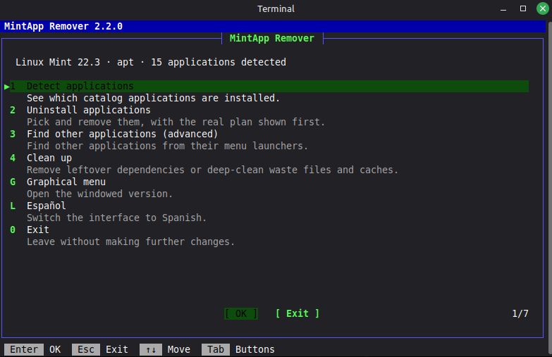
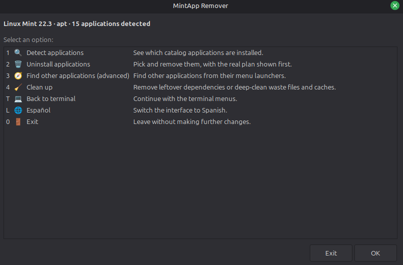
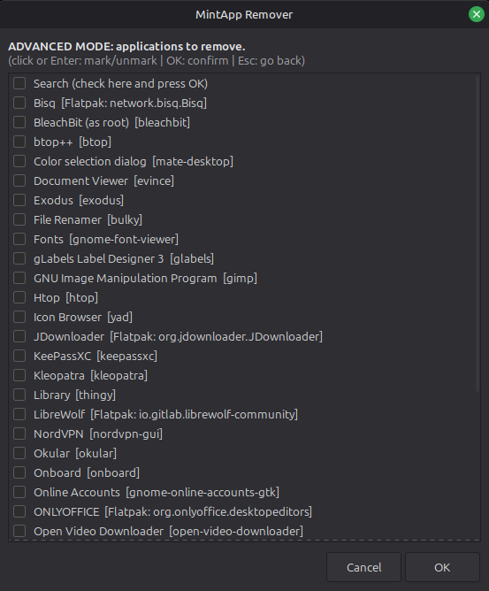
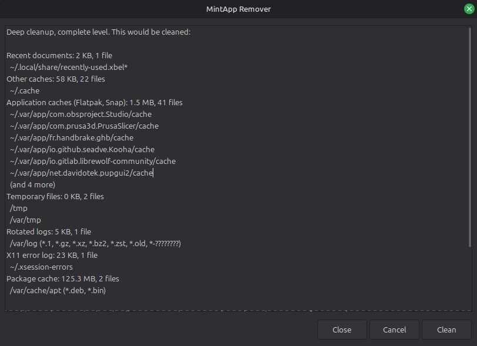
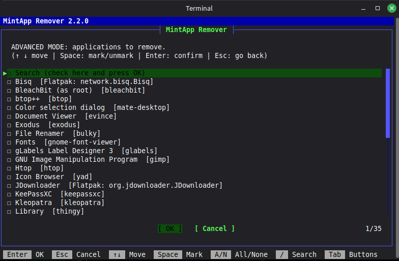
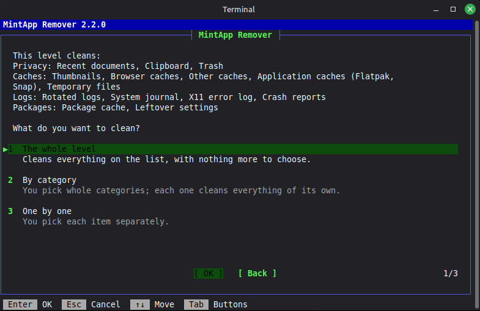

<p align="center">
  
</p>

<h1 align="center">MintApp Remover</h1>

<p align="center">
  Uninstaller and cleaner for Linux, in English and Spanish.<br>
  A single Bash script that shows you exactly what it will remove before it removes it.
</p>

<p align="center">
  <b>English</b> · <a href="README.es.md">Español</a>
</p>

<p align="center">
  <a href="LICENSE.txt"></a>
  
  
</p>

---

## What's new

Version 2.2.0:

- **Now bilingual: English and Spanish.** Until now the program spoke only Spanish. Every menu, plan, message and help text now comes in either language: it follows your system language and `L` switches it at any moment. This README is available in both languages too.
- **A real cleaner, not only a dependency remover.** Option 4 is now a [BleachBit](https://www.bleachbit.org/)-style cleaner with safe defaults: caches, logs, temporary files and traces of use, at two levels (simple and complete), always showing what and how much before anything is deleted. Cleaning dependencies is now just one of its two actions.
- **Beyond apt.** `dnf` (version 4), `pacman` and `zypper` are supported (see [Compatibility](#compatibility)). The manager is chosen at start; `MINTAPP_PM` forces one.
- **Flatpak and Snap can be removed.** They appear in Option 3 next to the packages, with their own plan, confirmation and record.
- **A catalog for each desktop.** Cinnamon, GNOME, KDE Plasma, XFCE and MATE each have their own application list and their own list of system components to leave alone.
- **Install and uninstall commands.** `install` puts a command, a menu launcher and the icon in your own folders, with no `sudo`. The launcher opens the graphical menu when there is no terminal, or a terminal if that was your last choice (`T`).
- **Meta-package guard.** If a plan would also remove meta-packages (the ones that hold a whole desktop together), it warns you and asks a stronger question.
- **One icon, inside the script.** The icon travels embedded in the script, so the file you download is all you need.
- **Still safe.** The plan is simulated, shown, confirmed and checked again before anything is removed, and every removal leaves a record.

## What it is

A small tool for two jobs, both without surprises: removing programs in an orderly way, and cleaning what a system accumulates (caches, logs, temporary files, traces of use).

A fresh Linux installation always has a few programs you will never use. Removing them by hand means knowing the exact package name (which rarely matches the name in the menu) and trusting that the removal will not take something along that it should not. **MintApp Remover** solves both: it gives you a checklist of the applications and, before removing anything, shows you the real result of the operation.

The cleaning works in the style of [BleachBit](https://www.bleachbit.org/), with defaults chosen to be safe: two levels (the simple one has age limits), nothing is deleted before you see what and how much, the default answer is "no", and the trash, which cannot be undone, is never marked for you. See Option 4 below.

It is not an "optimizer" and it does not promise miraculous gigabytes.

### Screenshots

Version 2.2.0 on Linux Mint 22.3 with `apt`. The program works in the terminal by default and in windows when you press `G` (or when it starts without a terminal).

<p align="center">
  
  <br><em>The main menu in the terminal. The first line says what the program found: the system, the package manager and how many catalog applications are installed.</em>
</p>

<p align="center">
  
  <br><em>The same menu in windows (`zenity`). `T` goes back to the terminal.</em>
</p>

<p align="center">
  
  <br><em>Option 3, advanced mode, in windows: applications found from the menu launchers, each with its package. Flatpak ones show their ID.</em>
</p>

<p align="center">
  
  <br><em>Option 4, deep cleanup (complete level), in windows. Before anything is deleted, the list shows what would be cleaned, where and how much. The default answer is `Cancel`.</em>
</p>

<p align="center">
  
  <br><em>Option 3 in the terminal: the same list. The last row lists the keys that work on the screen.</em>
</p>

<p align="center">
  
  <br><em>Option 4, deep cleanup, in the terminal: what the level cleans and, below, what you want to clean: the whole level, by category or one by one.</em>
</p>

## Advantages

Most scripts of this kind that circulate on forums are a fixed list of `sudo apt purge package1 package2 package3...`. If a package name changed between releases, or you have something installed that the author never considered, you are left halfway or, worse, you trust a list you did not review.

MintApp Remover does it differently:

- **It never removes anything before you see the real plan of the package manager.** With apt it runs `apt-get -s purge` (a simulation: it changes nothing and needs no administrator rights) and shows it as it is, including any dependent package that apt decides to drag along. You confirm (the default answer is "no"), the plan is checked again, and only then does it ask for your password.
- **The advanced mode does not depend on a fixed list.** It scans the real launchers of the application menu (`.desktop` files) and asks the package manager who owns each one, so it finds applications the catalog does not know about.
- **It leaves a trail.** Each removal is recorded in a private file with what was planned and the command to reinstall it.
- **The cleaning is cautious by default.** It shows what and how much before it deletes, the answer starts on "no", it only touches regular files in a fixed list of places, never follows links, never leaves the filesystem it started in and never deletes a file that a running program has open.
- **It works on whatever terminal you have.** Colors off with `NO_COLOR`, plain ASCII when the locale is not UTF-8, a plain-text menu when `whiptail` is not wanted, and windows (`zenity`) when there is no terminal at all.

## Compatibility

The requirement is `bash` 4.3 or newer plus the tools of one supported package manager. The program checks them at start and says what is missing.

| Level | System | Status |
|---|---|---|
| 1 | Debian, Ubuntu and derivatives (Linux Mint, Pop!_OS, Zorin, MX Linux, elementary OS...), with `apt` and `dpkg` | Supported and tested |
| 2 | Flatpak and Snap applications, on any of the systems here | Detected in Option 3; removal with plan, confirmation and record |
| 3 | Fedora, RHEL and derivatives (`dnf` 4 and `rpm`), Arch and derivatives (`pacman`), openSUSE and derivatives (`zypper`) | Supported and tested |
| — | Alpine, Void, Gentoo, BSD, macOS and other managers (`apk`, `xbps`, `nix`, `emerge`) | Out of scope |

About level 3:

- **`dnf` 5 (Fedora 41 and later) is not supported.** The program detects it and stops with a clear message.
- `dnf` refuses to calculate a plan without administrator rights, so with it the password is asked **before** the plan is shown. `apt`, `pacman` and `zypper` calculate it without.
- `rpm` has no "purge": with `dnf`, configuration files you changed stay as `.rpmsave`.
- The "Packages" items of the deep cleanup (package cache and leftover settings) exist only with apt. With the other managers, Option 4's first action cleans their cache.

The catalog of Option 2 depends on your desktop. The program reads your distribution and desktop (`/etc/os-release`, `XDG_CURRENT_DESKTOP`) and does not name them in its interface:

| Desktop | Entries in the catalog |
|---|---|
| Cinnamon (Linux Mint) | 25 |
| GNOME / Ubuntu | 43 |
| KDE Plasma | 30 |
| XFCE | 44 |
| MATE | 32 |
| Not recognized | all 110 |

An application whose packages are not installed is never shown, so a long list does not mean a long result. Option 3 is the portable part: it relies on a scan of the launchers, not on a fixed list, and each desktop has its own list of system components it leaves out.

## Installation

You need `bash` and one supported package manager. Nothing else: `zenity` (windows) and `whiptail` are optional.

**Clone the repository or download the ZIP:**

```bash
git clone https://github.com/Filonux/mintapp_remover.git
cd mintapp_remover
chmod +x script/MintApp_Remover.sh
./script/MintApp_Remover.sh
```

To keep it as a command with a menu launcher and an icon, run the same file with `install`:

```bash
./script/MintApp_Remover.sh install
```

This needs no `sudo` and writes only in your own folders:

| What | Where |
|---|---|
| Command `mintapp-remover` | `~/.local/bin/` |
| Menu launcher | `$XDG_DATA_HOME/applications/mintapp-remover.desktop` (`~/.local/share/...` by default) |
| Icon | `$XDG_DATA_HOME/icons/hicolor/512x512/apps/mintapp-remover.png` |

Running it again repairs or updates what changed and leaves the rest alone. If `~/.local/bin` is not in your `PATH`, the program tells you the line to add. Without `zenity` the launcher opens a terminal, since there would be nothing else to show.

Run it as a normal user, not with `sudo` in front: it asks for administrator rights only at the moment it really has to change something. It uses `sudo` or, if `sudo` is missing, `doas`.

## Usage

```
MintApp_Remover.sh [OPTION]
MintApp_Remover.sh install
MintApp_Remover.sh uninstall [DATA]

  -h, --help       Show the help and exit.
  -V, --version    Show the version and exit.
  --gui            Open the windows (zenity), even on a terminal.
  --terminal       Use the terminal; never open windows.
  --show-help      Show the key help again, even if you have seen it.
  install          Install the command, the menu launcher and the icon.
  uninstall        Remove them and ask what to do with your settings and
                   removal records. DATA skips the question:
                     --keep-records  delete the settings, keep the records
                     --keep-all      keep both
                     --purge         delete both, leaving no trace
```

Without a terminal (for example from the launcher) and with `zenity`, it opens the windows, unless your last choice was the terminal (`T`): then it opens a terminal emulator with the program.

On start, the first screen explains how to move around (shown once, until you ask for it again with `--show-help`). In short:

| Key | Action |
|---|---|
| `↑` `↓` | Move through the list, wherever the focus is |
| `Home` `End` · `PgUp` `PgDn` | First or last entry · one page at a time |
| `Space` | Mark or unmark an application; in a menu, choose the entry |
| `A` / `N` | Mark or unmark everything the list shows |
| `Enter` | Press the highlighted button |
| `Esc` or `Q` | Go back or cancel |
| `/` | Search long lists |
| `Tab` | Optional: switch to the buttons (`←` `→` work too) |
| `1` `2` `3` `4` `L` `G` `T` `0` | In the main menu, each key opens its option (`G` and `T` appear only when they apply) |

The last row of the screen always lists the keys that work on that screen.

The main menu:

```
1. Detect applications
2. Uninstall applications
3. Find other applications (advanced)
4. Clean up
G. Graphical menu        (only if zenity and a graphical session are available)
T. Back to terminal      (only in the windows, when a terminal can be opened)
L. Español
0. Exit
```

### 1 · Detect applications

Checks the catalog of your desktop (see [Compatibility](#compatibility); the full list is the `CATALOG_ALL` array in the script) and shows only the applications that are installed, with their package, version and size. It is a diagnostic step: it removes nothing.

### 2 · Uninstall applications

Runs the detection if it has not been done yet and shows the result as a checklist. Once you confirm the plan of the package manager it removes the selected packages, configuration files included where the manager can (`apt purge`; see the notes on `dnf` above). The search (`/`) ignores case and accents and looks at name, description and package.

### 3 · Find other applications (advanced)

The mode that does not depend on the fixed catalog. It scans `/usr/share/applications`, `~/.local/share/applications` and the folders where Flatpak and Snap export their launchers, identifies each launcher visible in the menu and asks the package manager which package it belongs to. It then discards automatically:

- what is already in the Option 2 catalog (so it is not repeated),
- components of the system itself (desktop shell, file manager, network manager, package manager, terminal, etc.) through the list of patterns of your desktop,
- any package that the system marks as essential or required (with apt: `Essential`, or priority `required` or `important`).

Flatpak and Snap applications are listed with the packages and removed after their own plan: `flatpak uninstall` (system or user installation, as found) and `snap remove`. Each one is removed on its own, so one that fails does not stop the rest. Launchers it cannot manage (an installation by hand, a Flatpak or Snap it cannot identify, or a file claimed by more than one package) are listed apart, labeled with their origin: `[Flatpak]`, `[Snap]`, `[manual install]` or the name of the manager.

Even with all these filters, the real plan is **always** shown before removing, and a plan that would drag meta-packages gets a warning and a stronger question. This is the mode meant to find third-party applications, desktop extensions that came as packages, or software you installed yourself and no longer use.

### 4 · Clean up

A cleaner in the style of [BleachBit](https://www.bleachbit.org/) with safe defaults, not only a dependency remover. Two actions:

**Clean up dependencies** removes the dependencies that are no longer needed (`apt autoremove` or the equivalent of your manager), after showing you the plan, and cleans the cache of downloaded packages. It shows an approximate figure of the space recovered.

**Deep cleanup** deletes waste files, caches, logs and traces of use. You choose the level, then the scope (the whole level, whole categories, or item by item). Before anything is deleted you see what is cleaned and how much space it frees, and you confirm. The defaults protect you: the confirmation starts on "no", item by item everything starts marked except the trash (which you must mark yourself), and by category nothing starts marked.

| Category | Item | Simple | Complete | Admin |
|---|---|:-:|:-:|:-:|
| Privacy | Recent documents lists | ✓ | ✓ | |
| | Clipboard (needs `xsel`, `xclip` or `wl-copy`) | ✓ | ✓ | |
| | Trash (permanent) | | ✓ | |
| Caches | Thumbnails | ✓ | ✓ | |
| | Browser caches (Firefox, Chrome, Chromium, Brave, Opera, LibreWolf, Thunderbird; open ones are skipped) | ✓ | ✓ | |
| | `~/.cache` | ✓ | ✓ | |
| | Flatpak and Snap application caches | ✓ | ✓ | |
| | Your files in `/tmp` and `/var/tmp` that are not in use | ✓ | ✓ | |
| Logs | Rotated system logs (`.1`, `.gz`, `.old`) | ✓ | ✓ | ✓ |
| | systemd journal | ✓ | ✓ | ✓ |
| | `~/.xsession-errors` | | ✓ | |
| | Crash reports and memory dumps | | ✓ | ✓ |
| Packages (apt only) | Downloaded `.deb` files | ✓ | ✓ | ✓ |
| | Settings of packages already removed | | ✓ | ✓ |

- **Simple** (low risk) has age limits: caches not used for 30 days, rotated logs and temporary files older than 7 days, and the journal keeps 14 days. It never touches the trash or what you may consider yours.
- **Complete** is the same without age limits, plus the rows marked only for it. In `~/.cache` it removes everything, and the archived journal goes.
- The **Admin** column marks what asks for administrator rights.
- It never deletes folders, files behind a link, files on another filesystem or files that are open. Outside your home folder it only works in `/tmp`, `/var/tmp`, `/var/log`, `/var/crash`, `/var/lib/systemd/coredump` and `/var/cache/apt`.
- It does not touch your documents, your settings or your browser profiles (passwords, bookmarks, history): of a browser it only clears the cache.

## How it works

A typical session, step by step:

1. Run `./script/MintApp_Remover.sh`. Read the first screen and press `Enter`.
2. Press `2`. The list shows what is installed. Move with `↑` `↓`, mark with `Space`, or press `/` to search. Confirm with `Enter` on **OK**.
3. The program calculates the removal with the package manager and shows the **real plan**, with every package that would go. Nothing has changed yet.
4. Confirm. The default answer is *Cancel*, so an accidental `Enter` removes nothing.
5. The plan is checked once more; only then does the program ask for your password (or, with `dnf`, it already did) and run the removal.
6. When it ends you get the result and the path of the record file. Then use Option 4 to clean leftover dependencies.

## Advanced configuration

All optional. Environment variables:

| Variable | Effect |
|---|---|
| `MINTAPP_UI=tui\|gui\|whiptail\|text` | Force the built-in dialogs (default on a terminal), the windows (`zenity`), `whiptail` or the plain-text menu. Without `zenity` or a graphical session, `gui` falls back to the default. `--gui` and `--terminal` win over it. |
| `MINTAPP_TERMINAL=name\|path` | Terminal emulator that `T` opens from the windows, and that the launcher opens when your last choice was the terminal. By default, the first one found: `x-terminal-emulator`, `gnome-terminal`, `konsole`, `xfce4-terminal`, `mate-terminal`, `lxterminal`, `qterminal`, `terminator`, `alacritty`, `kitty`, `xterm`. One you name that cannot be run is an error, never a silent fallback. |
| `MINTAPP_LANG=en\|es` | Force the interface language instead of detecting it. |
| `MINTAPP_PM=apt\|dnf\|pacman\|zypper` | Force the package manager. Any other value is an error, never a silent fallback. By default it is the one of your distribution, else the first one found. |
| `MINTAPP_ESC_WAIT=0.15` | Seconds to wait after `Esc` before taking it as the key itself (raise it on a slow SSH link). |
| `MINTAPP_LAUNCHER_DIRS=dir1:dir2` | Scan only these folders in Option 3. |
| `MINTAPP_SUDO=sudo\|doas\|path` | Command used to get administrator rights. |
| `NO_COLOR=1` | No colors (also with `TERM=dumb` or fewer than 8 colors). |
| `MINTAPP_ASCII=1\|0` | Plain ASCII (1) or Unicode symbols (0). By default ASCII is used when the locale is not UTF-8. |

Files the program writes (all private to your user, written atomically):

- `~/.local/state/mintapp-remover/`: one `removal-DATE-TIME-….txt` record per removal, with what was planned and how to reinstall it (`$XDG_STATE_HOME` is respected). It is written before the removal starts and replaced when it ends, so an interrupted run still leaves a record.
- `~/.config/mintapp-remover/config` (`$XDG_CONFIG_HOME` is respected), with three keys:

| Key | Values | Saved when |
|---|---|---|
| `interface` | `terminal`, `gui` | You switch with `G` or `T` |
| `language` | `es`, `en` | You switch with `L` |
| `help_seen` | `yes`, `no` | You have seen the first screen |

## Uninstalling the program

If you installed it with `install`:

```bash
mintapp-remover uninstall
```

It removes the command, the launcher and the icon, and asks what to do with your settings and removal records (keep the records if you want the reinstall commands of past removals). To skip the question add `--keep-records`, `--keep-all` or `--purge` (everything, leaving no trace). It only removes what it installed and leaves alone anything else it finds in those places.

If you only ran it from the folder you cloned, delete the folder and, if you want, what it wrote:

```bash
rm -r ~/.local/state/mintapp-remover ~/.config/mintapp-remover
```

## Scriptya

The first lines of the script carry the metadata that Scriptya reads (`# MENU`, `# DESCRIPTION`, `# CONFIRM`, `# TERMINAL`, `# SUDO`, `# ICON`), so it can be listed there as it is. `# ICON` points to `../assets/icon5.png`; the same image travels inside the script.

## Language and roadmap

Both the program and this README are available in English and Spanish. The program picks the language from `LANGUAGE`, `LC_ALL`, `LC_MESSAGES` or `LANG` (in that order; anything that is not Spanish gives English), unless you saved one with `L` or set `MINTAPP_LANG`.

Done, and ideas without a committed date:

- [x] `install` and `uninstall` commands, with menu launcher and icon
- [x] Remove Flatpak and Snap applications, with plan and confirmation
- [x] Bilingual program and README (English and Spanish)
- [x] BleachBit-style cleanup in two levels (simple and complete), with safe defaults and sizes shown before deleting
- [x] Catalogs and exclusion patterns for GNOME/Ubuntu, KDE Plasma, XFCE and MATE
- [x] Support for `dnf`, `pacman` and `zypper`
- [x] Graphical menu as the default when there is no terminal (launcher)
- [x] Back to the terminal (`T`) from the windows; the launcher remembers the choice
- [x] Screenshots in this README
- [ ] Package as a `.deb`

## Tests

The program removes packages, so its tests are part of the product. They do three things:

- **They check the program.** The suites run it from start to finish in an isolated sandbox, with stand-ins for `apt`, `dpkg`, `sudo` and the other managers, so they never touch the real system. They check what this README promises: the plan shown is the one the package manager reports, nothing is removed before you confirm, a flow cut off at any step ends cleanly and leaves nothing behind, and every text exists in both languages and fits the width of the terminal.
- **They back the workflows.** GitHub Actions (`.github/workflows/quality.yml`) runs ShellCheck, the Bash syntax check and every suite on each push or pull request that changes `script/`, `tests/`, the embedded icon or the workflow itself, and repeats the suites on Debian 12 and 13, Ubuntu 22.04 and 24.04 and on a real `bash` 4.3. A change that breaks something shows up in its pull request.
- **They make changes easier.** Each suite covers one area, so after a change you run the suite of that area and the failing check names what moved. That is what allows rewriting or extending the script with confidence (see [`CONTRIBUTING.md`](.github/CONTRIBUTING.md)).

```bash
bash tests/run_all.sh          # every suite
bash tests/run_all.sh --list   # the suites and what each one checks
bash tests/run_all.sh clean    # only the suites you name
bash tests/lint.sh             # ShellCheck 0.11.0, no findings allowed
```

The suites (over 7,700 checks) cover the texts in both languages, the catalogs of each desktop, the configuration, `install` and `uninstall` (including the embedded icon, compared pixel by pixel with the one in `assets/`), the package-manager layer, Flatpak and Snap, the menus and removal flows end to end, the search, the cleaning and the windows. The `pm` suite also runs the real `rpm`, `dnf`, `pacman` and `zypper` against fake roots when they are installed, and the `gui` suite drives the real `zenity` when `zenity`, `Xvfb`, `openbox` and `xdotool` are installed (with `xterm` as well, it also checks that the launcher hands the program over to a real terminal). A skipped check always says why.

## Contributing

Contributions are welcome. Before opening an *issue* or a *pull request*, take a look at [`CONTRIBUTING.md`](.github/CONTRIBUTING.md) and [`CODE_OF_CONDUCT.md`](.github/CODE_OF_CONDUCT.md). To report a security vulnerability, follow the process in [`SECURITY.md`](.github/SECURITY.md) instead of opening a public issue.

## Acknowledgements

The catalog of the deep cleanup follows the cleaners of [BleachBit](https://www.bleachbit.org/) (GPL-3.0-or-later), adapted; each entry in the script names the ones it follows.

## License

MintApp Remover is free software distributed under the terms of the **GNU General Public License version 3 (GPLv3)**. See [`LICENSE.txt`](LICENSE.txt) for the full text.

Copyright (C) 2026 Filonux

---

<p align="center">Made by <b>Filonux</b></p>
